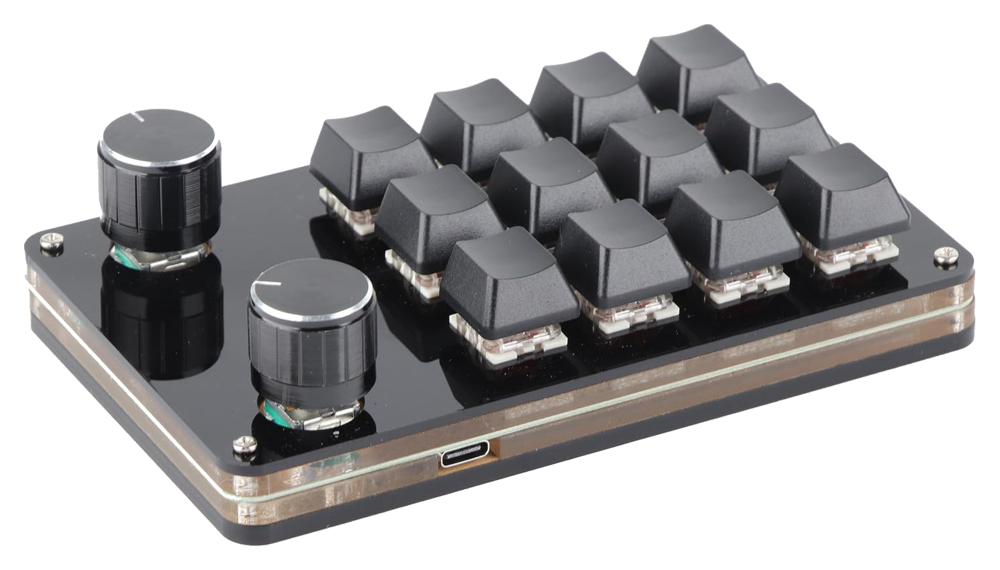
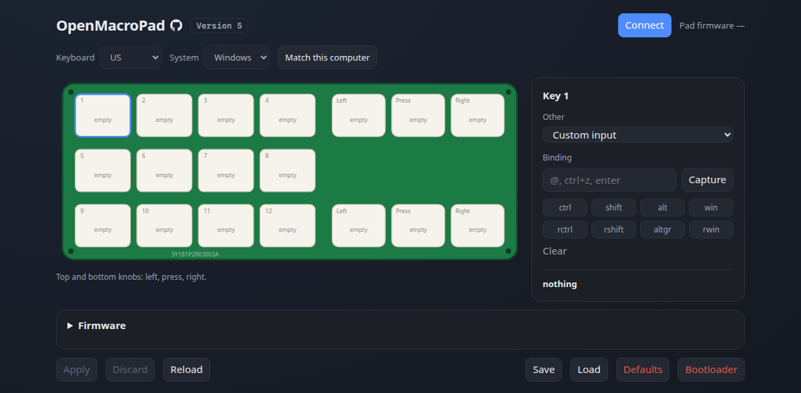

# Open firmware for a CH552G macropad

Replacement firmware and a browser-based configurator for a cheap 12-key,
2-knob macropad built around a CH552G and a TM1650.

Every key and both knobs are freely bindable to keystrokes, key combinations,
media controls or mouse actions. Bindings are stored on the device, so they
follow it to any computer, and they are changed over USB without reflashing and
without installing a driver.

This already works and can be used day to day, but it is still early and needs
polish. The configurator UX and support for other board variants have rough
edges. Treat it as a solid starting point rather than a finished product;
improvements and pull requests are very welcome.

## Why this exists

These pads are sold with a Windows-only configuration tool and firmware built
for a different variant of the same board. The silkscreen reads `12+3`: twelve
keys and three encoders. The unit here has two encoders, and the stock firmware
exposes only two encoder actions in total, so of the six things the knobs can
physically do (turn either way, press, on each knob) only two could be bound.
Both knobs were effectively dead weight.

Before replacing the firmware we reverse-engineered the factory HID protocol and
built tooling to drive it. That worked for the keys, and an exhaustive sweep of
all 256 binding identifiers confirmed the limitation was in the firmware itself
rather than in the tooling: the missing knob actions simply are not implemented.
The stock firmware also cannot be read back for a backup, which we established
empirically before overwriting it.

So the firmware was replaced outright. That work is what this repository
contains; the factory-protocol tooling is not included, since none of it applies
any more. If you would rather keep the stock firmware and just rebind what it
does expose, [padclaude](https://github.com/barkleesanders/padclaude) speaks
that protocol on macOS and is where our understanding of it started. This
project shares no code with it and replaces the firmware it talks to.

## Hardware compatibility

**This has been tested on exactly one device.** It is known to work on a board
silkscreened `SY181P2R03003A 12+3` populated with twelve keys and two rotary
encoders, using a CH552G and a TM1650.

It will very likely need changes on anything else, including the three-encoder
version of this same board. The pin map, the TM1650 scan codes and the encoder
GPIO assignments were all determined by measurement on this one unit, and there
is no reason to assume another batch matches.

If you have a different variant, [`docs/HARDWARE.md`](docs/HARDWARE.md)
documents the pin map and includes a discovery firmware that reports what your
board actually does. Reports and pull requests for other hardware are very
welcome; broadening support is the main thing this project needs.

## What you can bind

Each of the 18 slots (twelve keys, plus press, left and right for each knob) can
send:

- **Keys and chords** &mdash; anything from `F13` to `ctrl+shift+esc` or `win+e`,
  including the function keys, the numeric keypad and any raw HID usage
- **Media and applications** &mdash; volume, playback, browser navigation,
  calculator, screen lock, display brightness
- **Mouse actions** &mdash; the five buttons including back and forward, scroll
  wheel, horizontal scroll and pointer movement, with an adjustable step size.
  Shift and the other keyboard modifiers can be held with them. Media keys
  cannot.

By default the keys send F13 to F24, which no application binds out of the box,
and the knobs handle volume and media playback.

## Getting started

Open [`tools/webui/index.html`](tools/webui/index.html) in Chrome or Edge and
click **Connect**. The header shows Version 5. Firefox and Safari cannot
connect. Keys, knobs, layout and OS are edited on that page. See
[`docs/CONFIGURING.md`](docs/CONFIGURING.md).

If the pad is not yet on firmware 1.2.2 or newer, flash the full image once
before opening the page. Stock firmware, 1.0.0, 1.1.0 and 1.2.0 cannot take
an update from the page. The file is `firmware/prebuilt/padfw-1.2.3.bin`
(13376 bytes). Python is only for that flash. Follow
[`docs/FLASHING.md`](docs/FLASHING.md).

A pad already on 1.2.2 or newer updates from the Firmware section of the same
page, with `firmware/prebuilt/padfw-1.2.3.web.bin` (8168 bytes).

Both files are separate downloads on the
[1.2.3 release](https://github.com/EpicLPer/CH552-OpenMacroPad/releases/tag/v1.2.3).
The page itself is in this repository, under `tools/webui/`.

## Documentation

| Document | Contents |
| --- | --- |
| [`docs/FLASHING.md`](docs/FLASHING.md) | Drivers, bootloader entry, flashing, building from source, recovery |
| [`docs/CONFIGURING.md`](docs/CONFIGURING.md) | The configurator, every binding, profiles, known quirks |
| [`docs/HARDWARE.md`](docs/HARDWARE.md) | Pin map, how it was traced, and how to port to other boards |
| [`firmware/README.md`](firmware/README.md) | Firmware internals, storage format, notes for anyone modifying it |
| [`CHANGELOG.md`](CHANGELOG.md) | Release history |

## Known limitations

- Characters and letter shortcuts follow the host layout stored on the pad
  (US, UK, German, French or Spanish) and the OS set next to it. Set both on
  the page, once per computer. Other layouts are not included. A character
  the layout has no key for is typed with a Windows or Linux fallback, and
  does nothing on macOS. See
  [`docs/CONFIGURING.md`](docs/CONFIGURING.md#host-keyboard-layout).
- Bindings are single actions. There are no multi-keystroke macros, no text
  strings and no layers.
- One action per slot, so a key cannot behave differently on a long press.
- The knobs have no acceleration; one detent is always one action.
- The configurator is Chrome or Edge. The one-time flash on Windows needs the
  Zadig driver in [`docs/FLASHING.md`](docs/FLASHING.md). Linux needs the udev
  rule there.

## Licence

Two licences, because the firmware builds on third-party code with a
share-alike obligation:

- **`firmware/`** is CC BY-SA 3.0. The USB HID stack comes from Stefan Wagner's
  [CH552-Macropad-mini](https://github.com/wagiminator/CH552-Macropad-mini) and
  [CH552-USB-Knob](https://github.com/wagiminator/CH552-USB-Knob), which carry
  that licence, and the firmware is compiled together with it.
- **`tools/`** and **`docs/`** are MIT. They share no code with the firmware and
  only talk to the device over USB.

See [`LICENSE`](LICENSE) for the details.

## Credits

- [wagiminator](https://github.com/wagiminator) for the CH552 USB HID stack and
  the `chprog` flashing tool, both of which this builds on directly.
- WCH for the CH552 and its un-erasable ROM bootloader, which makes the board
  very hard to brick permanently.
