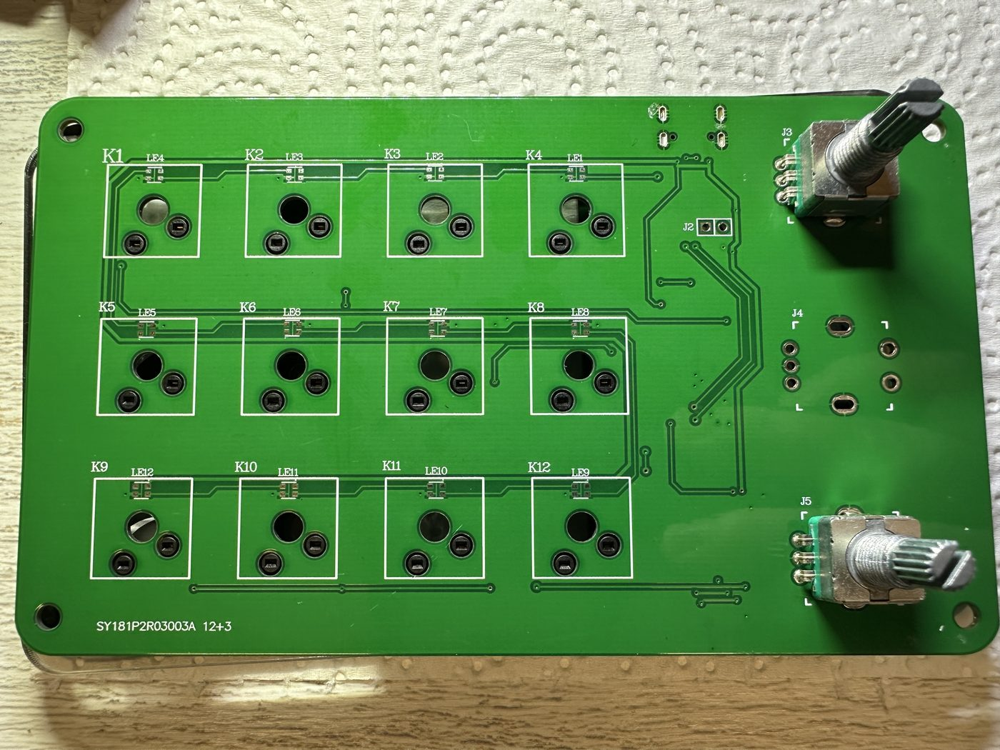
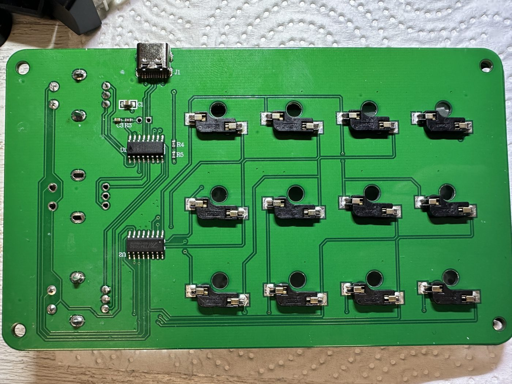

# Hardware: the SY181P2R03003A "12+3" board

`U1` = WCH **CH552G** (SOP-16, marking `405845D36`), `U2` = Titan **TM1650**
(SOP-16, marking `N2351PVB0051MT`). Two-layer board. The silkscreen advertises
twelve keys and three encoders; the unit documented here has two encoders
fitted, and the third footprint is routed but empty.

No public pin map exists for this board, so everything below was worked out from
scratch: first by tracing high-resolution photographs of both sides, then
confirmed by measurement from the chip itself using the discovery firmware
described at the end.

**This describes one physical unit.** Another batch, and certainly the
three-encoder variant, may differ. If you are porting to different hardware,
skip to [Porting to another board](#porting-to-another-board).

| | |
| --- | --- |
|  |  |

## Chip orientation

Both packages use the standard SOP-16 convention: pin 1 at the bottom-left when
the part marking reads normally, numbering counter-clockwise.

**U1 (CH552G)** sits upright in the board view (USB-C at top). The `CH552G`
marking reads left to right, the `U1` designator is at its lower-left, and the
pin-1 dimple is on the left edge. Confidence: high.

- Bottom row, left to right = pins 1-8: `P3.2` `P1.4` `P1.5` `P1.6` `P1.7` `RST` `P3.1` `P3.0`
- Top row, left to right = pins 16-9: `V33` `VCC` `GND` `UDM` `UDP` `P3.4` `P3.3` `P1.1`

**U2 (TM1650)** is rotated **180 degrees** relative to U1. In the board view its
`TM1650` and `U2` markings are upside down and the pin-1 dimple is at the
top-right of the body. Confidence: high. This inversion is the easiest thing to
get wrong when probing, so check it first.

- Top row, left to right = pins 8-1: `A/KI1` `DIG4` `DIG3` `DIG2` `GND` `SCL` `SDA` `DIG1`
- Bottom row, left to right = pins 9-16: `B/KI2` `C/KI3` `D/KI4` `E/KI5` `F/KI6` `G/KI7` `VDD` `DP/KP`

## Confirmed nets

### TM1650 bus: `P3.3` + `P3.4`

Confidence: high. Traced end to end across both layers:

1. On the back, U2 pin 2 (`SDA`) runs straight up into a via, and U2 pin 3
   (`SCL`) runs diagonally up-right into a second via. The two vias sit
   north-east of U2, stacked vertically.
2. Those vias surface on the front and feed a **parallel pair of traces** that
   runs diagonally up-right, then turns north.
3. The pair terminates at two more vias, which mirror to a position immediately
   north of U1's top row.
4. On the back, those two vias have short stubs curving down onto U1 **pin 11
   (`P3.4`)** and **pin 10 (`P3.3`)**.

Adjacent pins carrying a routed-together pair is exactly the signature of a
2-wire bus, and it leaves 8 GPIOs for 6 encoder lines, which fits.

Within the pair, the SDA/SCL split is **inferred, not proven** (confidence:
moderate). Following the pair's handedness through its bends gives:

- `P3.3` -> U2 pin 2 (`SDA` / data)
- `P3.4` -> U2 pin 3 (`SCL` / clock)

One continuity check settles it: buzz U2 pin 3 against `P3.3` and `P3.4`.
Failing that, firmware can try both - a 2-wire bus with clock and data swapped
simply returns nothing.

### `J4` third encoder is fully routed

Confidence: high. The middle-right footprint is silkscreened `J4`, has three
plated signal holes plus two mounting slots, all unpopulated, and has traces
running from the signal holes toward U1. Fitting an EC11 gives a third knob the
stock firmware never offered.

### `J2` is the bootloader header

**Confirmed by the owner.** Two through-hole pads on the front, just inboard of
the USB-C connector, silkscreened `J2`. Shorting them while plugging in USB puts
the chip into the WCH ISP bootloader; this has already been done successfully
once with a WCH flashing tool. No clipping onto SOP-16 legs required.

Practical note: with valid firmware present the bootloader hands off to the
application after a few seconds, so the ISP window is short. Have the flash
command typed and ready *before* plugging in. Once the code flash has been
erased there is no application to hand off to, so the window should stop being a
constraint after the first flash.

## Measured by the discovery firmware

Everything below was read off the hardware itself by `discovery.c`, not
inferred. No multimeter was needed in the end.

### TM1650 bus split: confirmed

`SDA` = `P3.3` (pin 10), `SCL` = `P3.4` (pin 11), exactly as the trace
handedness suggested. The chip acknowledged and reported the datasheet's
documented idle key value of `0x2E`.

### Encoders

Both are electrically alive, including the bottom one the stock firmware never
drove. The A/B lines are plain GPIOs; only the switches go through the TM1650.

| Encoder | A | B | Switch (TM1650) |
| --- | --- | --- | --- |
| Top | `P3.2` (pin 1) | `P1.4` (pin 2) | `0x67` = `KI5`/`DIG4` |
| Bottom | `P3.0` (pin 8) | `P1.1` (pin 9) | `0x57` = `KI3`/`DIG4` |

Direction convention, from three clockwise then three counter-clockwise turns of
each knob:

- **Clockwise**: A falls first, giving `FF -> FE -> FC -> FD -> FF` on the top
  knob and the `BF` variant on the bottom one.
- **Counter-clockwise**: B falls first, giving `FF -> FD -> FC -> FE -> FF`.

Both encoder switches share `DIG4`, which is consistent with them being wired as
their own group rather than folded in with the key matrix.

### Keys

**Key 1 is not on the TM1650.** It is wired straight to `P1.5` (pin 3) and
reads active-low against the internal pull-up. Only keys 2-12 go through the
matrix. This is easy to misread as a faulty matrix key, because pressing key 1
produces a GPIO event and no key code at all.

That arrangement is almost certainly deliberate: a key on a plain GPIO can be
sampled before the TM1650 is initialised, which makes it the natural
hold-at-power-on bootloader trigger. This firmware uses it for exactly that.

Keys were pressed top-left to bottom-right. The electrical grouping does not
follow the physical rows: `DIG1` and `DIG2` each carry five keys.

| Key | Source | KI | DIG |
| --- | --- | --- | --- |
| 1 (top left) | `P1.5` GPIO, active low | - | - |
| 2 | `0x44` | KI1 | DIG1 |
| 3 | `0x4C` | KI2 | DIG1 |
| 4 | `0x54` | KI3 | DIG1 |
| 5 | `0x5C` | KI4 | DIG1 |
| 6 | `0x64` | KI5 | DIG1 |
| 7 | `0x45` | KI1 | DIG2 |
| 8 | `0x4D` | KI2 | DIG2 |
| 9 | `0x55` | KI3 | DIG2 |
| 10 | `0x5D` | KI4 | DIG2 |
| 11 | `0x65` | KI5 | DIG2 |
| 12 (bottom right) | `0x46` | KI1 | DIG3 |
| Top knob press | `0x67` | KI5 | DIG4 |
| Bottom knob press | `0x57` | KI3 | DIG4 |

A press sets bit 6; releasing reports the same code with bit 6 clear, so `0x44`
pressed reads back as `0x04` released.

All fourteen switches are accounted for and working.

### Still free

`P1.6` (pin 4), `P1.7` (pin 5), `P3.1` (pin 7) - three pins, enough for the
unpopulated `J4` third encoder plus one spare.

`RST` (pin 6) is not a usable GPIO. `R3` (marked `102`, 1 k) sits near U1 and may
be its pull-up.

## Open questions

Which pins `J4` uses, if a third encoder is ever fitted. Two of `P1.6`, `P1.7`
and `P3.1`. One more discovery run with an EC11 soldered in would settle it.

## Porting to another board

`firmware/discovery.c` is a throwaway firmware whose only job is to tell you
what your hardware is. Rather than needing a logic analyser, it reports findings
by typing them out as keystrokes, so any text editor is the readout.

```
cd firmware
python build.py discovery.c --flash
```

Open a text editor, then work through the pad methodically: press each key in a
known order, press each knob, then turn each knob three detents in each
direction. Write down which physical action produced which line. That mapping is
the whole point of the exercise and is tedious to reconstruct afterwards.

What it reports:

- `BUS OK SDA=Pxx SCL=Pxx` if it finds a TM1650 answering on the pins named in
  `src/config.h`, along with the idle key value. Edit `PIN_TM_SDA` and
  `PIN_TM_SCL` there and rebuild if your board wires it differently.
- `Knn` for every TM1650 key event. A press sets bit 6, so a key reporting `K44`
  pressed reports `K04` released.
- `Gnn` whenever any of the candidate GPIOs in `GPIO_CANDIDATES` changes, as a
  bitmask. Encoder A/B lines and any key wired directly to a pin show up here.

Two things caught us out and are worth expecting. Not every key is necessarily
on the matrix: on this board key 1 is wired straight to a GPIO, which looks
exactly like a dead matrix key until you notice a GPIO event with no key code.
And the electrical grouping need not follow the physical layout, so do not
assume the first row of keys shares a `DIG` line.

Once you have the mapping, transfer it into `firmware/src/config.h` (pin
assignments) and the `KEYCODES` table in `firmware/padfw.c` (scan code to slot),
then build `padfw.c` normally.

Output is free-running for the first two minutes after power-on and gated behind
Scroll Lock afterwards, so a board that reports continuously cannot make the
machine unusable.

Pull requests adding support for other variants are very welcome. The most
useful contribution would be making the pin map and key table configurable per
board rather than compiled in, which is currently the main obstacle to
supporting more than one layout.
